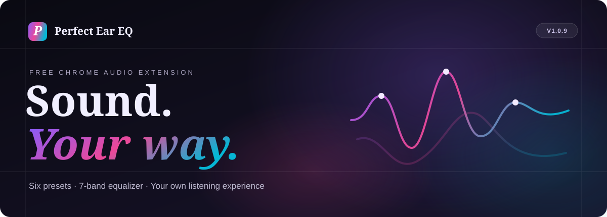
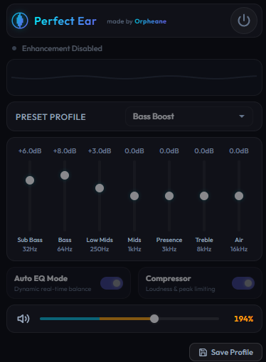

 

### Clearer. Stronger. More personal.

A free audio equalizer for the Chrome tab you're using. Find a sound that feels right — from balanced music and deeper bass to more understandable voices.

 

  

Free to install · Six sound presets · Private by design · Version 1.0.9

  

[Discover](#discover-a-better-way-to-listen) &nbsp; · &nbsp; [See the interface](#a-look-at-the-interface) &nbsp; · &nbsp; [Explore the sound](#find-your-sound) &nbsp; · &nbsp; [Install](#ready-to-hear-the-difference)

---

## Discover a better way to listen

Sometimes, your favorite song needs a little more depth. A podcast feels too quiet. A voice in a tutorial gets lost behind everything else.

**Perfect Ear EQ brings your listening experience back into your hands.**

Choose a ready-made sound, fine-tune the seven-band equalizer, or let optional real-time Auto EQ and compression help shape the audio. Everything is made for everyday listeners — you don't need to be an audio expert.

**What you can do**

- Hear **deeper bass** with a dedicated Bass Boost preset.
- Bring **speech forward** with the Voice preset.
- Get **more volume from quiet sources**, with boost settings up to 600%.
- Create **your own signature sound** with Custom.
- Enjoy a real-time visualizer in four styles and choose between 16 interface themes.

> Perfect Ear EQ processes audio in the **Chrome browser tab you choose**. It does not change your computer's system-wide audio.

---

## A look at the interface

 

Real Perfect Ear EQ interface preview from the developer's portfolio; an earlier design is shown. For the latest screenshots, visit the <a href="https://chromewebstore.google.com/detail/perfect-ear-eq/kigpbihaamfjdieahgdboignbjgohbbi">official Chrome Web Store gallery</a>.

---

## Find your sound

<em>Six ways to listen. One extension that adapts to you.</em>

| | Preset | Listening experience |
|:--:|:--|:--|
| ♪ | **Music** | Balanced sound for songs, videos and everyday entertainment |
| ♫ | **Bass Boost** | More low-end impact, without complicated tuning |
| ◉ | **Voice** | Clearer speech in podcasts, calls, tutorials and videos |
| ◇ | **Cinema** | Fuller film sound with a moderate bass lift and a touch of presence |
| ☁ | **Soft** | Warmth and gentler highs for relaxed listening |
| ✦ | **Custom** | Your EQ settings plus independently controlled Auto EQ and compressor |

Use the left and right arrows to browse your presets. **Browsing alone never changes the sound** — the preset applies when you select it.

### Made yours. Remembered automatically.

Custom saves your seven-band EQ values and your independent Auto EQ and compressor choices, even after switching presets or reopening the extension. No need to start over every time.

---

## More control, without more complexity

### A seven-band equalizer

Adjust low, middle and high frequencies to your taste. Start with a preset, then move to Custom when you want something more personal.

### Optional Auto EQ and compression

**Auto EQ** dynamically adjusts your listening experience in real time. The **compressor** helps reduce the contrast between loud and quiet passages. Choose either, both, or neither in Custom.

### Extra volume for quiet recordings

Bring quiet podcasts, lectures, tutorials and older recordings up with **volume boost up to 600%**. A **look-ahead brickwall peak limiter** helps prevent output clipping when boosting audio.

> **Good to know:** 600% is the available boost setting, not a guaranteed sixfold increase in perceived loudness. Loud sources can reach the output limit sooner. Results depend on the audio and your equipment. Start at a safe listening level.

### A look that feels like yours

A real-time audio visualizer with **four styles** and **16 interface themes** gives the extension a personal touch without complicating the controls.

---

## Designed to stay personal

Perfect Ear EQ is free, lightweight and focused on audio. According to the developer's privacy disclosures:

**No ads. No personal data collected or transmitted. No external requests.**

Settings and diagnostics stay on your device. The extension uses only permissions needed to enhance selected tab audio. For the latest disclosures, check the [official Chrome Web Store listing](https://chromewebstore.google.com/detail/perfect-ear-eq/kigpbihaamfjdieahgdboignbjgohbbi).

---

## What's new

<strong>Version 1.0.9 — More ways to find your sound</strong>

Cinema and Soft join the preset collection, alongside a dedicated Custom preset that remembers your EQ, Auto EQ and compressor settings. Horizontal navigation lets you browse all six presets without affecting the current sound until selection.

<strong>Version 1.0.8 — More volume for quieter audio</strong>

Maximum boost increased from 300% to 600%, with a new look-ahead brickwall limiter designed to improve peak control and reduce clipping. The higher settings primarily benefit quieter recordings, while Auto EQ, Bass Boost and the visualizer retain their existing behavior.

---

## A few things worth knowing

<strong>Is Perfect Ear EQ free?</strong>

Yes. It's free to install from the official Chrome Web Store, with no ads according to the developer.

<strong>Do I need to understand audio frequencies?</strong>

Not at all. Choose Music, Bass Boost, Voice, Cinema or Soft for a quick starting point. Custom is there when you want finer control.

<strong>Does it work with online music, videos and podcasts?</strong>

Perfect Ear EQ is designed for audio in a selected Chrome tab, such as browser-based music, videos and podcasts. It is not a system-wide desktop equalizer, and results depend on the source audio.

<strong>Will I lose my settings if I switch presets?</strong>

No. Your Custom EQ, Auto EQ and compressor choices are saved automatically and remain available after reopening the extension.

<strong>Can it make extremely loud audio even louder?</strong>

Higher boost values are mainly useful for quiet audio. A recording already close to the output limit may not become perceptibly louder, even at higher settings.

---

## Ready to hear the difference?

### Your sound. Your choice.

No complicated setup. No endless menus. Just the tools to make everyday browser audio feel more like yours.

 

  

**[Open Perfect Ear EQ on the Chrome Web Store](https://chromewebstore.google.com/detail/perfect-ear-eq/kigpbihaamfjdieahgdboignbjgohbbi)**

 

Perfect Ear EQ · Created by <a href="https://github.com/Orpheane">Orpheane</a>

---

About this repository: This is the public presentation of Perfect Ear EQ, not the extension's source code or an alternative download service. Install through the official Chrome Web Store. Public repository visibility does not grant an open-source license.
