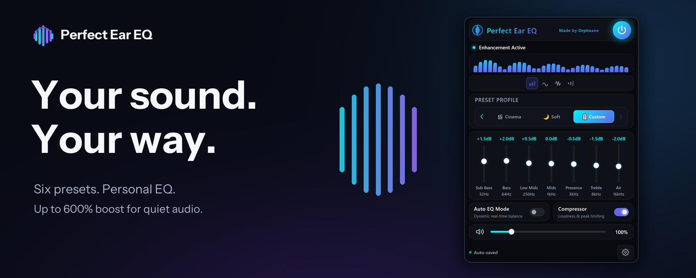
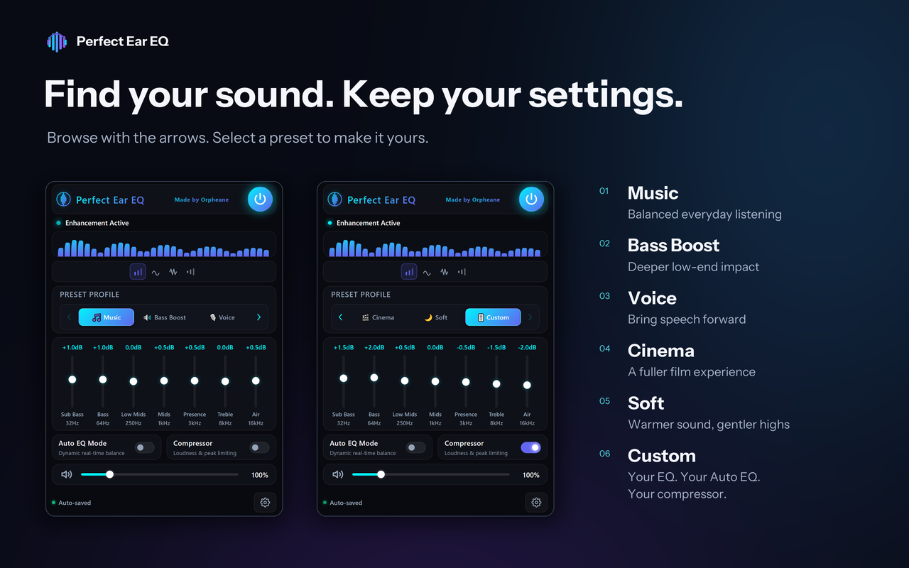
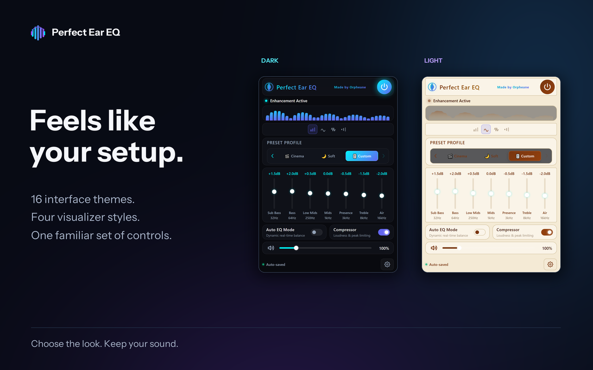

  

### Better audio, the way you like it.

**A free Chrome audio equalizer with six presets, a personal 7-band EQ, real-time Auto EQ, optional compression, and volume boost for quiet browser-tab audio.**

 

  

Free · No ads · No personal data collected · Version 1.0.9

---

## Your browser audio, made personal.

Music that could use a little more depth. Voices that get lost in the mix. A video that's just too quiet.

**Perfect Ear EQ gives you simple, flexible audio controls for the Chrome tab you're listening to.** Start with a preset, fine-tune the seven frequency bands, or switch on Auto EQ and compression whenever you prefer.

The goal is simple: **make the sound fit you, not the other way around.**

### The essentials

- **Six sound presets** — Music, Bass Boost, Voice, Cinema, Soft and Custom.
- **7-band equalizer** — adjust your sound manually, from low bass to high frequencies.
- **Real-time Auto EQ** — optional dynamic audio adjustment.
- **Optional compressor** — helps even out quiet and loud passages.
- **Up to 600% volume boost** — particularly helpful for quiet podcasts, tutorials and older recordings.
- **Look-ahead brickwall peak limiter** — helps prevent output clipping.
- **Four visualizer styles and 16 interface themes** — make the extension feel like yours.
- **Auto-saved settings** — your Custom EQ and separate Auto EQ / compressor choices stay remembered.

---

## Find your sound.

A little more bass for your playlist. Clearer speech in a podcast. A warmer sound for an evening movie. Choose what feels right in the moment.

| Preset | Made for |
|:--|:--|
| **Music** | Balanced everyday listening |
| **Bass Boost** | Deeper low-end impact |
| **Voice** | Bringing speech forward |
| **Cinema** | A fuller film experience |
| **Soft** | Warmer sound and gentler highs |
| **Custom** | Your EQ, your Auto EQ, your compressor |

Use the left and right arrows to browse presets. **Browsing doesn't change your audio until you select one.** Custom remembers your personal EQ and independently enabled or disabled Auto EQ and compression, even after switching presets or reopening the extension.

---

## Feels like your setup.

Your listening tools should feel good to use, too.

Choose from **16 interface themes**, explore **four real-time audio visualizer styles**, and keep the familiar controls you already know. Change the appearance without having to rebuild your listening settings.

---

## More of what you want to hear.

### Fine-tune the details

The seven-band equalizer gives you direct control over your sound. Want a quick change? Choose a preset. Want your own balance? Move into Custom and save your preferences automatically.

### Let Auto EQ and compression help

Turn on **real-time Auto EQ** for dynamic sound adjustment. Enable the **compressor** to help smooth differences between louder and quieter passages. In Custom, each can be controlled independently.

### Give quiet audio room to be heard

Boost low-volume browser audio **up to 600%**, with a look-ahead brickwall peak limiter to help control output peaks. It's designed for sources that are genuinely too quiet.

> **Listening note:** A 600% boost setting does not guarantee six times the perceived loudness. Louder recordings may already reach the output limit at lower boost settings. Results depend on the audio source and playback equipment; start at a safe listening volume.

---

## Private by design.

Perfect Ear EQ focuses on enhancing audio in the Chrome tab you select — **not on collecting personal information**.

According to the extension's developer disclosures, it has **no ads, no personal data collection or transmission, no external requests**, and keeps settings and diagnostics on your device.

Only permissions needed to enhance selected tab audio are requested. See the [official Chrome Web Store listing](https://chromewebstore.google.com/detail/perfect-ear-eq/kigpbihaamfjdieahgdboignbjgohbbi) for the latest permissions and privacy information.

---

## What's new in 1.0.9?

**More ways to listen, with less effort.**

**Cinema** and **Soft** join the preset collection, while the new **Custom** preset retains your seven-band EQ settings and your independent Auto EQ and compressor choices. Horizontal navigation lets you preview presets before selecting one.

The preceding **1.0.8** release increased available boost from 300% to 600% and introduced a look-ahead brickwall limiter for improved peak control.

---

## Good to know

<strong>Is Perfect Ear EQ free?</strong>

Yes. The extension is free to install through the official Chrome Web Store and has no ads according to the developer's description.

<strong>Does it enhance audio on my whole computer?</strong>

No. Perfect Ear EQ enhances audio in the **Chrome browser tab you choose**, not system-wide desktop or game audio.

<strong>Can I use it for podcasts, videos and music?</strong>

Yes. The presets are designed for everyday browser listening: balanced music, deeper bass, clearer speech, fuller film audio and warmer, gentler sound.

<strong>Will I lose my custom sound when switching presets?</strong>

No. Custom remembers your EQ values plus your independent Auto EQ and compressor choices across preset switches and when reopening the extension.

<strong>Can it make every recording dramatically louder?</strong>

Not necessarily. The higher boost settings are mainly useful for quiet sources. Recordings already near the output limit may not get significantly louder.

---

### Ready to hear the difference?

**Your sound. Your way.**

 

  

<a href="https://chromewebstore.google.com/detail/perfect-ear-eq/kigpbihaamfjdieahgdboignbjgohbbi"><strong>Visit the official Chrome Web Store page</strong></a>

  

Made by <a href="https://github.com/Orpheane">Orpheane</a> · Perfect Ear EQ v1.0.9

---

This repository is a public product showcase, not the Chrome extension's source code or a separate extension download. Install via the official Chrome Web Store. Public repository visibility does not imply an open-source license.
